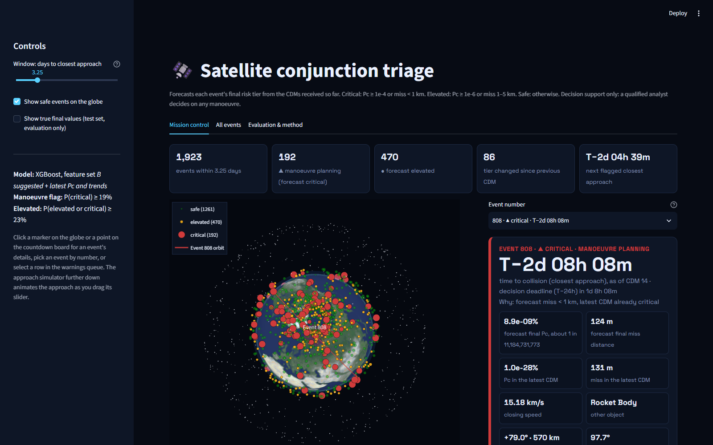
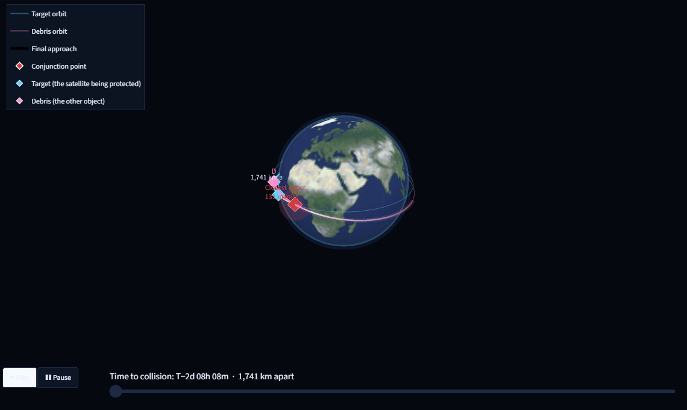
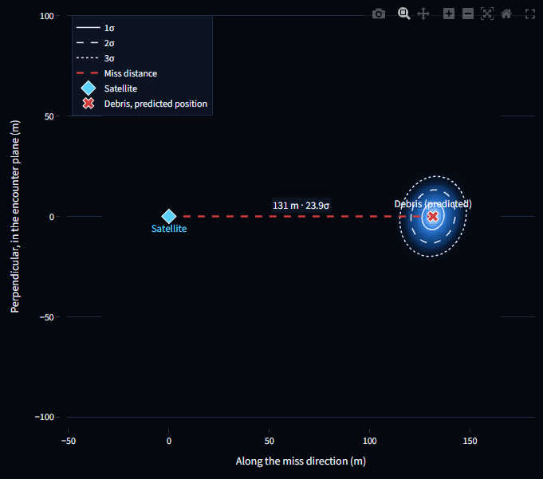

# 🛰️ Satellite Collision Risk Evaluator

A machine-learning pipeline and interactive Streamlit dashboard that reads satellite **conjunction data
messages (CDMs)**, forecasts each close-approach event's **final risk tier** with a calibrated probability,
and flags the events that need **manoeuvre planning**.




---

## Contents

1. [The problem](#1-the-problem)
2. [Risk tiers](#2-risk-tiers)
3. [How the model works](#3-how-the-model-works)
4. [Results](#4-results)
5. [The dashboard](#5-the-dashboard)
6. [Run it](#6-run-it)
7. [Project structure](#7-project-structure)
8. [Limitations](#8-limitations)
9. [Credits](#9-credits)

---

## 1. The problem

When two objects in orbit are predicted to pass close to each other, the satellite operator receives a
series of CDMs in the days before the **time of closest approach (TCA)**. Each CDM gives the predicted
miss distance, the relative position and velocity, the position uncertainty of both objects, and the
collision probability `Pc` (stored here as `risk = log10(Pc)`). Every new CDM refines the estimate, and
the risk can rise or fall as TCA approaches.

The operator has to decide early, while there is still time to plan a manoeuvre, **which events will end
up dangerous**. This project forecasts that outcome from the CDMs received so far.

**Data** (CDM schema of the ESA Kelvins Collision Avoidance Challenge, 103 columns):

| File | CDMs | Events | Use |
|---|---|---|---|
| `train_data.csv` | 162,634 | 13,154 | training only |
| `test_data.csv` | 24,484 | 2,167 | evaluation only |

The raw data is not included in this repository (about 270 MB); see [Run it](#6-run-it).

## 2. Risk tiers

`Pc = 10^risk`. Tiers follow NASA (NASA/SP-20205011318) and ESA Space Debris Office practice:

| Tier | Rule | Action |
|---|---|---|
| 🔴 **Critical** | Pc ≥ 1e-4 (`risk ≥ -4`) **or** miss distance < 1,000 m | manoeuvre planning required |
| 🟠 **Elevated** | not critical, and Pc ≥ 1e-6 **or** miss distance 1,000–5,000 m | monitor closely |
| 🟢 **Safe** | Pc < 1e-6 **and** miss distance > 5,000 m | routine screening |

The rule is implemented once, in `common.tier_code`, and used by training, evaluation, the dashboard and
the tests. The miss-distance part matters: on the test set, 186 events end critical under the full rule,
but only 23 would on Pc alone.

## 3. How the model works

### What is predicted

The test file stops **2 days before TCA**: every test event's last CDM is at ≥ 2 days. So an event's
label is the tier of its **last CDM at ≥ 2 days** (its "final" CDM), and the model forecasts it from the
**earlier CDMs of the same event**. The final CDM is never an input: if it were, the tier would just be
the formula above and there would be nothing to learn.

The training data is cut at 2 days in the same way, so training and test examples are built
identically. Every earlier CDM produces one example (the forecast available after that CDM), weighted so
that each event counts once.

```
event 1085:  CDM1   CDM2   CDM3  ...  CDM13 | CDM14 (final, ≥ 2 days before TCA)
             └──────── inputs ─────────────┘   └── label: tier of this CDM
```

### Features

Three feature sets were compared by **grouped 5-fold cross-validation** (grouped by event, so no event is
in both the training and validation folds), on the training data only:

| Set | Features | What it adds |
|---|---|---|
| **A** | 12 | the columns suggested in the brief, from the latest CDM |
| **B** ✅ | 29 | A + the latest CDM's own Pc and tier, the most severe tier so far, and how risk, miss distance and `max_risk_estimate` have changed across the event's CDMs (change since the previous CDM, rate per day, first value, extremes so far) |
| **C** | 57 | B + full position/velocity uncertainty, covariance determinants, Mahalanobis distance, miss distance over combined sigma, relative velocity and both orbits |

Set **B** had the lowest calibrated log loss and was chosen automatically. The final tier is mostly
"the current tier, unless the trend says otherwise", which the suggested single-CDM columns cannot
express. Set C added the physics of the uncertainty but did not improve the forecast further.

### Model

- **Tier classifier:** XGBoost, 3 classes, giving P(safe), P(elevated), P(critical).
- **Calibration:** temperature scaling fitted on out-of-fold predictions, so a 70% really means about 70%.
- **Decision thresholds**, tuned for F2 on out-of-fold predictions (recall weighted over precision,
  because missing a dangerous event costs far more than a false alarm):
  - **critical / manoeuvre flag:** P(critical) ≥ 19%
  - **elevated:** P(elevated or critical) ≥ 23%
- **Forecasts of final Pc and final miss distance:** two XGBoost regressors predicting the *change* from
  the latest CDM.

Features, calibration and thresholds are all chosen on training data. `evaluate.py` scores the test set
with those fixed settings.

## 4. Results

Test set, per event (2,092 events with at least two CDMs; 75 single-CDM events cannot be forecast and are
reported separately). The baseline is **persistence**: apply the tier rule to the latest CDM received,
i.e. assume nothing changes.

| Metric | Model | Persistence baseline |
|---|---|---|
| Critical recall | **0.899** | 0.866 |
| Critical precision | 0.782 | **0.852** |
| Critical F2 | **0.873** | 0.863 |
| Criticals called safe | **2** | 3 |
| Safe events flagged | 4.8% | **3.5%** |
| Final miss distance RMSE (log10 m) | **0.154** | 0.168 |
| Final log10 Pc RMSE | 0.706 | **0.665** |

Across **every** update (not only the latest one before the final CDM), the model calls **38** eventually
critical CDM updates safe, against **64** for persistence: it warns earlier.

**Calibration** of P(critical) on the test set: events given 80–100% were critical 96% of the time,
events given under 5% were critical 0.5% of the time.

**Reading the results honestly.** Tiers rarely change between the last two CDMs, so persistence is a strong
baseline. The model's value is in catching events that are *becoming* critical, earlier and more often,
at the cost of more false alarms. Its Pc forecast does not beat persistence, so the dashboard uses the
tier probabilities, not the forecast Pc, to flag events.

## 5. The dashboard

`streamlit run app.py` opens a dark, mission-control style dashboard with three tabs.

### Mission control

| Panel | What it shows |
|---|---|
| **Status tiles** | events in the window, manoeuvre-planning events, elevated events, tier changes, next flagged closest approach |
| **3D Earth** | every event as a marker (NASA Blue Marble texture), coloured by forecast tier and sized by P(critical), at its real conjunction latitude and altitude. **Click a marker** to open a pop-up with that event's details and history. Drag to rotate, or press Spin |
| **Countdown card** | for the selected event: a large T−countdown to closest approach, decision-deadline status, why it is flagged, forecast and latest Pc and miss distance, and the tier probabilities |
| **Countdown board** | all events plotted by time to closest approach against P(critical), with the manoeuvre threshold. Click a point to open it |
| **Warnings queue** | critical then elevated events, soonest first, with a CSV download. Select a row to focus the event |
| **Event history + replay** | Pc and miss distance over the event's CDMs (observed vs forecast), plus P(critical) after each CDM. A replay slider steps through the CDMs |
| **Approach simulator** | the selected event only: satellite and debris moving along their orbits towards closest approach. Drag the slider or press Play; the label shows time to collision and separation live |
| **Close approach** | key numbers (miss components, relative speed, how many σ the satellite sits from the debris's predicted position, crossing time); an **animated 3D fly-by** with full-covariance 1σ/3σ uncertainty ellipsoids; and the **encounter plane** used by conjunction analysts |
| **Response plan** | a step-by-step checklist for the tier, with an along-track Δv estimate and adjustable lead times |

| Approach simulator | Encounter plane |
|---|---|
|  |  |
| Drag the slider or press Play; the satellite (T) and debris (D) move along their orbits and meet at the conjunction point. | Event 808: critical because its miss is 131 m (under 1 km), yet the satellite sits 23.9σ from the debris's predicted position, which is why its Pc is effectively zero. |

### All events

Forecast Pc against forecast miss distance with the tier boundaries, and a full sortable table.

### Evaluation & method

Model vs baseline, confusion matrices, the calibration chart, the feature-set comparison with the reasons
for the extra columns, the top features, and the known limits.

A sidebar toggle shows the true final values for evaluation; it is off by default so the dashboard behaves
as it would in operations.

## 6. Run it

Requires Python 3.12+ (developed on 3.13).

```bash
git clone https://github.com/divyanshiskpandey-ui/Satellite-Collision.git
cd Satellite-Collision
python -m venv .venv
.venv\Scripts\activate            # Windows   (macOS/Linux: source .venv/bin/activate)
pip install -r requirements.txt

streamlit run app.py              # opens http://localhost:8501
```

The trained models and test predictions are included in `outputs/v2/`, so **the dashboard runs straight
away without the raw data**.

To retrain from scratch, put the two CSV files in `data/` and run:

```bash
python train.py                   # training data only: CV, feature choice, calibration, thresholds, final fit (~2 min)
python evaluate.py                # scores the test set and rewrites outputs/v2/
python tests/test_pipeline.py     # checks (also runs with pytest)
```

## 7. Project structure

```
├── app.py                    Streamlit dashboard
├── orbit_view.py             3D Earth, approach simulator, close-approach views, response plan
├── common.py                 tier rule, example and feature building, metrics (shared by everything)
├── train.py                  training pipeline (training data only)
├── evaluate.py               scores the test set, writes the dashboard's inputs
├── tests/test_pipeline.py    tier boundaries, no final-CDM leakage, grouped folds, saved metrics consistent
├── outputs/v2/               trained models, meta.json (features, thresholds), test predictions and metrics
├── assets/                   NASA Blue Marble Earth texture
├── docs/screenshots/         images used in this README
├── .streamlit/config.toml    dark theme
├── requirements.txt
└── data/                     (not committed) train_data.csv, test_data.csv
```

The tests check that:

- the tier rule is right at every boundary (exactly Pc 1e-4, 1e-6, 1 km and 5 km);
- an event's features do not change when only its final CDM changes (no leakage of the label);
- grouped folds never put the same event in training and validation;
- the saved metrics match the saved predictions, and every displayed tier follows from the stored
  probabilities and thresholds.

## 8. Limitations

- **"Final" means the last CDM at ≥ 2 days**, not the CDM at closest approach, because the test data stops
  there.
- **Globe longitude is illustrative.** The data has each conjunction's latitude and altitude but no
  longitude, so events are spread evenly around the Earth. The selected event's orbit is drawn at its
  real inclination.
- **Orbits in the simulator use two-body dynamics** from the CDM's relative state (no drag or Earth
  oblateness), so positions are exact at closest approach and approximate days earlier.
- **The encounter plane is an approximation**: both objects' covariances are combined in the satellite's
  RTN frame. A Pc recomputed this way only loosely matches the dataset's `risk`, so the dashboard shows
  the CDM's own Pc, not a recomputed one.
- **Pc in the data is floored at 1e-30** (`risk = -30`); below 1e-10 it is treated as 1e-10.
- **Decision support only.** A qualified analyst makes any manoeuvre decision.

## 9. Credits

- CDM data provided with the assignment (ESA Kelvins Collision Avoidance Challenge format).
- Earth texture: NASA Visible Earth, *Blue Marble: Land Surface, Shallow Water, and Shaded Topography*
  (public domain).
- Built with XGBoost, scikit-learn, pandas, Streamlit, Altair and Plotly.
